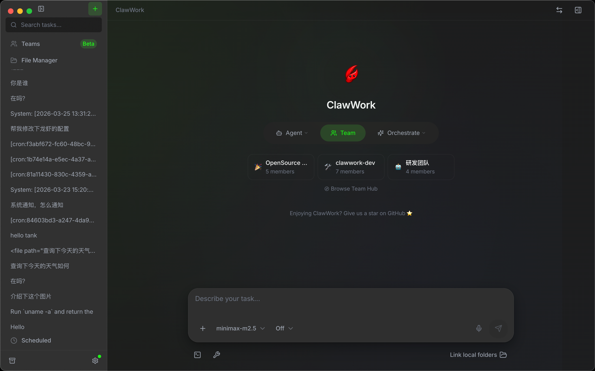
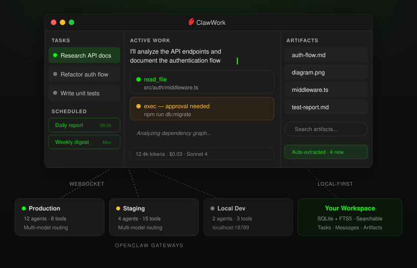

<div align="center">

<table border="0" cellspacing="0" cellpadding="0"><tr>
<td></td>
<td></td>
</tr></table>

**English** · [简体中文](./README.zh.md) · [繁體中文](./README.zh-TW.md) · [日本語](./README.ja.md) · [한국어](./README.ko.md)

# ClawWork

**The local-first workspace for the Agent OS era.**

Desktop client for [OpenClaw](https://github.com/openclaw/openclaw) — run agent tasks in parallel, keep artifacts durable, and find your files later.

[](https://github.com/clawwork-ai/clawwork/releases/latest)
[](LICENSE)
[](https://github.com/clawwork-ai/clawwork)
[](https://discord.gg/n9fCgBMgm)

[Download](#download) · [**PWA**](https://cpwa.pages.dev) · [Quick start](#quick-start) · [Teams](#teams) · [What you get](#what-you-get) · [Data & architecture](#data--architecture) · [Repo layout](#repo-layout) · [Roadmap](#roadmap) · [Contributing](#contributing) · [Keynote](https://clawwork-ai.github.io/ClawWork/keynote/)

</div>

> **⚠️ Official Repository**
> This is the **official** ClawWork project: https://github.com/clawwork-ai/clawwork
>
> A copycat repository (ClawWorkAi/ClawWork) and website (clawworkai.store) have been found without proper attribution. Please be aware and use the official links above.
>
> Official Website: https://clawwork-ai.github.io/ClawWork/

## Why ClawWork

**Agents are multiplying. The bottleneck is no longer capability — it's the operator surface.**

As agent runtimes proliferate, users end up juggling sessions across chat windows, web UIs, and terminals, each with its own context and no shared memory. Just as IDEs became the operator layer for code and terminals for Unix, the Agent OS needs a workspace layer. ClawWork is building that layer — starting as the best-in-class client for OpenClaw, extensible toward a multi-runtime future.

### Today: OpenClaw, without the chat-history mud

OpenClaw is powerful. Plain chat is a bad container for the kind of work it can do.

Once you have multiple sessions, long-running jobs, approval stops, generated files, recurring automation, and different gateways, chat history turns into mud. Status vanishes. Files vanish. Context vanishes.

ClawWork fixes that. Every task becomes a durable workspace with its own session, artifacts, controls, and history — laid out in a three-panel UI: tasks on the left, active work in the center, artifacts and context on the right.

### ClawWork vs messaging channels

**The dedicated UI for OpenClaw — stop chatting with Agents in Feishu.**

|                | Feishu / DingTalk / Slack  | ClawWork                                              |
| -------------- | -------------------------- | ----------------------------------------------------- |
| Layout         | Single chat thread         | Three-column: task list, conversation, progress panel |
| Multi-task     | One conversation at a time | Parallel tasks in isolated sessions                   |
| Tool calls     | Hidden or text-only        | Real-time visualization with expandable details       |
| Artifacts      | Lost in chat history       | Auto-saved to local Git repo, searchable              |
| Progress       | No structured tracking     | Step-by-step progress panel                           |
| Data ownership | On third-party servers     | 100% local (SQLite + Git)                             |

## Demo

> **Launch prep:** Record a 60-second demo and save as `docs/demo.gif`. See [docs/promotion/demo-recording.md](./docs/promotion/demo-recording.md) for the checklist.

## Teams

One agent is useful. A coordinated team of agents is a workforce.

ClawWork Teams package multiple agents into a single deployable unit — roles, personalities, skills, and workflow included. A **coordinator** agent breaks down the task and delegates to **worker** agents, each running in its own sub-session. You see the full orchestration in real time.

```
skill → agent → team
```

### Team structure

```
teams/clawwork-dev/
├── TEAM.md                  # team metadata and workflow
└── agents/
    ├── manager/             # coordinator — orchestrates the team
    │   ├── IDENTITY.md      # role and prompt
    │   ├── SOUL.md          # personality and style
    │   └── skills.json      # skill dependencies
    ├── architect/            # worker — designs solutions
    ├── frontend-dev/         # worker — builds UI
    ├── core-dev/             # worker — builds core logic
    └── ...
```

### Three ways to get a team

- **[TeamsHub](https://github.com/clawwork-ai/teamshub-community)** — browse and install community-contributed teams from a Git-native registry.
- **Create manually** — define agents, identities, and skills in a step-by-step wizard.
- **AI Builder** — describe what you need and let an LLM design the team structure, roles, and prompts for you.

Once installed, pick a team when creating a task. The coordinator takes over from there.

## Download

### Homebrew (macOS)

```bash
brew tap clawwork-ai/clawwork
brew install --cask clawwork
```

### Releases

Prebuilt macOS, Windows, and Linux builds are available on the [Releases page](https://github.com/clawwork-ai/clawwork/releases/latest). The app updates itself — new versions download in the background and install when you quit.

### PWA (browser)

No install required — open **[cpwa.pages.dev](https://cpwa.pages.dev)** in any modern browser. Works on desktop and mobile, installable to your home screen.

## Quick start

1. Start an OpenClaw Gateway.
2. Open ClawWork and add a gateway in Settings. Authenticate with a token, password, or pairing code. Default local endpoint: `ws://127.0.0.1:18789`.
3. Create a task, pick a gateway and agent, and describe the work.
4. Chat: send messages, attach images, `@` files for context, or use `/` commands.
5. Follow the task as it runs, inspect tool activity, and keep the output files.

## What you get

### ⚡ Task-first workflow

- Parallel tasks with isolated OpenClaw sessions — archived tasks can be reopened later
- Per-gateway session catalogs
- Session controls that matter: stop, reset, compact, delete, and sync
- Background work that stays readable instead of collapsing into one long thread
- Set tasks on a schedule with `cron`, `every`, or `at` expressions — pick from presets or write your own, check run history, trigger manually anytime ([recipe examples](./docs/scheduled-workflow-recipes.md))
- Export any session as Markdown to keep a clean record outside the app

### 👁 Better visibility

- Streaming responses in real time
- Inline tool call cards while the agent works
- Progress and artifacts in a side panel
- See what you're spending — usage status per gateway, cost breakdown per session, 30-day rolling dashboard

### 🎛 Better control

- Multi-gateway support
- Per-task agent and model switching
- Manage your agents directly — create, edit, delete, and browse their workspace files without leaving the app
- Browse the full tools catalog for each gateway so you know what the agent can reach
- Thinking level controls and slash commands
- Approval prompts for sensitive exec actions
- Get notified when things happen in the background — task completions, approval requests, gateway disconnects — click a notification and it jumps back to the task. Per-event toggles so you control the noise.

### 📂 Better file handling

- Context that is actually useful: images, `@` file references, voice input, watched folders
- Point the app at up to 10 folders and it watches for changes, re-indexing automatically so your context stays fresh
- Local artifact storage
- Code blocks and remote images in assistant replies are auto-extracted and saved to your workspace — no manual copy-paste
- Full-text search across tasks, messages, and artifacts

### 🖥 Better desktop ergonomics

- System tray support
- Quick-launch window with a global shortcut (`Alt+Space` by default, customizable)
- Keyboard shortcuts throughout the app
- The app updates itself in the background — you see progress in Settings and it installs on quit
- Zoom in or out to your comfort level, and the app remembers your preference
- Light and dark themes with 8 languages

### 🔧 Debugging

- Export a debug bundle (logs, gateway status, sanitized config) when something goes wrong — useful for bug reports
- See which Gateway server version you're connected to right in Settings

## Data & architecture

ClawWork talks to OpenClaw through a single Gateway WebSocket connection. Each task gets its own session key for isolation, and everything lives in a local workspace directory you choose — no cloud sync, no external database.

- **Tasks** — each one maps to an independent OpenClaw session, so parallel work never collides.
- **Messages** — user, assistant, and system messages, including tool calls and image attachments, all persisted locally.
- **Artifacts** — code blocks, images, and files the agent produces. Automatically extracted from assistant output so nothing gets lost.
- **Full-text search** — search across all of the above. Find that one code snippet from three weeks ago without remembering which task it came from.

<div align="center">

</div>

## Repo layout

```
packages/shared/       — protocol types, constants (zero deps)
packages/core/         — shared business logic: stores, services, ports
packages/desktop/
  src/main/            — Electron main: gateway WS, IPC, DB, artifacts, OS integration
  src/preload/         — typed window.clawwork bridge
  src/renderer/        — React UI: components, layouts, stores, hooks, i18n
packages/pwa/          — Progressive Web App (browser + mobile)
docs/                  — design docs, architecture invariants
e2e/                   — Playwright E2E tests (smoke + gateway integration)
scripts/               — build and check scripts
website/               — project website (React + Vite)
keynote/               — presentation slides (Slidev)
```

## Tech stack

Electron 34, React 19, TypeScript, Tailwind CSS v4, Zustand, SQLite (Drizzle ORM + better-sqlite3), Framer Motion.

## Platform notes

- Voice input requires a local [whisper.cpp](https://github.com/ggerganov/whisper.cpp) binary and model.
- Auto-updater works on packaged builds only; dev mode skips updates.
- Context folder watcher: max 10 directories, 4 levels deep, files up to 10 MB.

## Roadmap

### ✅ Shipped

- Multi-task parallel execution with per-task session isolation
- Multi-gateway auth (token, password, pairing code)
- Scheduled (cron) tasks with run history
- Usage and cost dashboard across gateways and sessions
- Full-text search across tasks, messages, and artifacts
- Teams and TeamsHub — build, share, and install multi-agent ensembles
- Skills via ClawHub — discovery and install
- AI Builder — LLM-assisted team creation
- PWA with offline support and mobile UI ([cpwa.pages.dev](https://cpwa.pages.dev))
- Cross-platform: macOS, Windows, Linux (AppImage + deb), with auto-update

### 🔮 Next up

- Conversation branching
- Artifact diff view
- Custom themes
- Session templates for recurring workflows
- Extension API documentation for Skills, Teams, and Adapters

### 🌐 Vision — the Workspace layer of the Agent OS

ClawWork today is optimized for OpenClaw. We're building toward a future where the workspace layer is runtime-agnostic — one operator surface for every agent you touch.

- **Multi-runtime adapters** — bring agents from other runtimes into the same task / session / artifact model · [design direction →](./website/src/docs/en/2026-04-24-next-multi-runtime-control-plane.md)
- **Richer team orchestration** — coordination patterns beyond coordinator / worker
- **Enterprise-friendly local-first** — stronger data boundaries and team collaboration patterns without giving up local data ownership

Items move up into _Next up_ as they get scoped. Nothing in this section is a promise of timing.

## Star History

[](https://star-history.dera.page/#clawwork-ai/ClawWork&type=date&legend=top-left)

## Contributing

To contribute:

- Read [DEVELOPMENT.md](DEVELOPMENT.md) for setup and project structure
- Check [Issues](https://github.com/clawwork-ai/clawwork/issues)
- Open a [Pull Request](https://github.com/clawwork-ai/clawwork/pulls)
- Run `pnpm check` before submitting — it gates lint, architecture, UI contract, renderer copy, i18n, dead code, formatting, typecheck, and tests.

## License

[Apache 2.0](LICENSE)

<div align="center">

Built for [OpenClaw](https://github.com/openclaw/openclaw). Inspired by the great work of [Peter Steinberger](https://github.com/steipete).

</div>

## 📱 手机端适配（荣盈魔方 / 魔方罗盘，2026-10-22）

手机端与桌面端同一网关（OpenClaw 引擎 2026.9.3），由 `packages/pwa`（Capacitor Android App + PWA 网页，`/m/` 入口）提供：

| 功能 | 说明 |
| --- | --- |
| 语音输入 | 三通道自动切换：系统语音引擎 → 云端转写（桌面端 relay 中转 `/api/mobile/voice/transcribe`）→ Web Speech；长按说话 + 三泡泡（取消 / 录音时长 / 发送），松手写入输入框 |
| 扫码配对 | App 内扫码（兼容 JSON 与 URL 两种二维码）；桌面端收到 `device.pair.requested` **自动批准**，全程免手动 |
| 结构化提问 | `ask_user` 问题面板（`operator.questions` scope，网关事件闸门） |
| 执行授权 | exec 审批弹层（审批副连接 `caps=exec-approvals`，事件只放行 `exec.approval.*`） |
| 工具状态 | 定稿投影：历史消息里的工具调用不再卡「执行中」（对齐桌面端 `markUnreportedCalls`） |
| 双端同步 | 消息 / 任务 / 会话状态实时同步（轮询 + 事件流双通道） |

### 手机端构建

```bash
cd packages/pwa
pnpm build:app && npx cap sync android
cd android && ./gradlew app:assembleRelease   # 产物：app/build/outputs/apk/release/app-release.apk

# 网页版（桌面端 18780 /m/ 入口，dev 态读 packages/pwa/dist）
pnpm build
```

### 接入方式

1. 电脑端启动，网关监听 `18789`，远程入口 `18780`
2. 手机 App 扫码或粘贴配对链接（桌面端「设置 → 通用 → 移动端」生成）
3. 桌面端自动批准新设备，手机直接进入主界面

> ⚠️ 语音转写消耗电脑端账号的云端 ASR 额度（与桌面端语音同一账户按量计费）。
> ⚠️ Android 原生壳需 `CAMERA` / `RECORD_AUDIO` / `MODIFY_AUDIO_SETTINGS` 权限（Capacitor 权限请求缺一即整体拒绝）。
