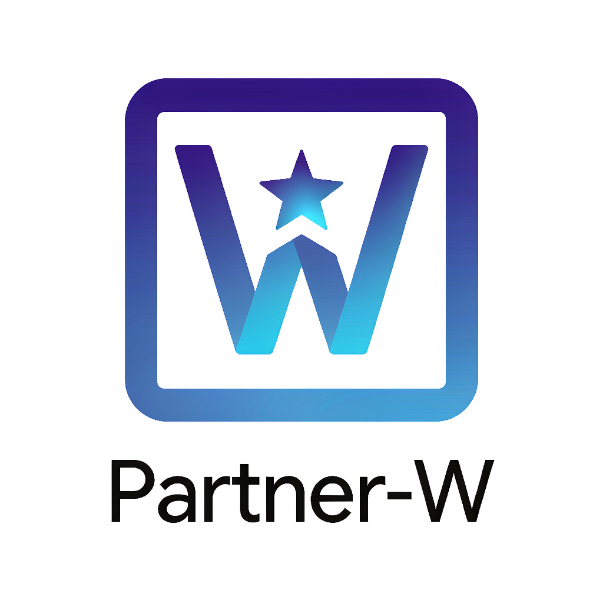
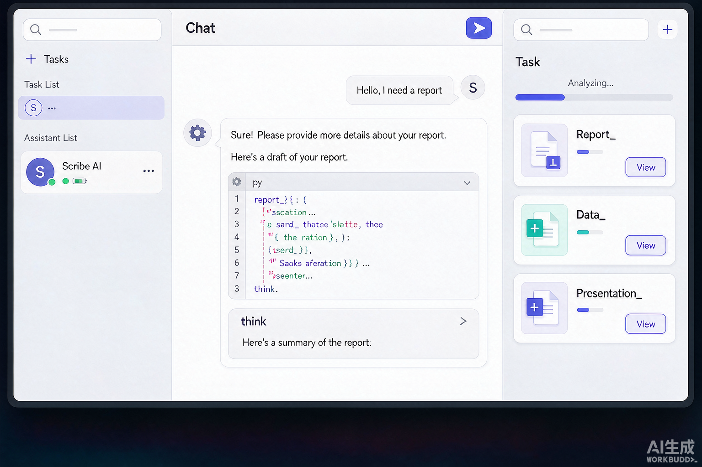

<div align="center">



# Partner-W

面向 Windows 大众用户的 AI 桌面工作台

本地部署、联网调用云端模型，用「用途引导 + 任务模板 + 文件处理 + 模型服务」，
让用户从「不知道怎么问」走到「完成了一件事」。

</div>

---

## 目录

- [产品定位](#产品定位)
- [核心能力](#核心能力)
- [界面一览](#界面一览)
- [模型服务](#模型服务)
- [用途引导与助手团队](#用途引导与助手团队)
- [文件与内容生成](#文件与内容生成)
- [本地部署与本地数据](#本地部署与本地数据)
- [技术架构](#技术架构)
- [安装教程（普通用户速通）](#安装教程普通用户速通)
- [快速开始](#快速开始)
- [技术栈](#技术栈)
- [仓库结构](#仓库结构)
- [开发与验证](#开发与验证)
- [设计原则](#设计原则)
- [许可](#许可)

---

## 产品定位

Partner-W 面向**第一次接触或不熟悉 AI 工具的大众 Windows 用户**，也服务于内容创作者、短视频从业者、职场用户、电商运营者、学习研究者和家庭用户。

用户在本机安装部署客户端，希望快速完成一项**具体任务**，而不是先学习 Agent、模型、Token、网关这类技术概念。因此产品的目标是：**新用户登录后三分钟内，完成第一次真实的 AI 任务**，并且能清楚看到余额、使用记录和下一步操作。

产品克制、可信、易用：不堆术语、不做游戏化包装，用真实结果建立信任——余额、模型、回复来源和失败原因始终一致可见。

## 核心能力

- **任务工作台**：三栏界面（任务 / 对话 / 进度），多任务并行、各自独立会话，可归档、可导出；
- **用途引导**：首屏给出可执行的预设任务与能力入口，先问用途，再推荐助手、模型与任务；
- **专业助手与团队**：内置多个预设助手，支持把多个智能体组成团队（协调者 + 工作者）协作完成复杂任务；
- **文件生成**：直接产出 Word、Excel、PPT 三种办公文档；
- **图片与视频生成**：文生图 / 图生图 / 文生视频 / 图生视频；
- **模型服务**：内置云端中转模型 + 自配模型端点（BYOK），每个端点多个模型、每个模型 4 档推理功率；
- **本地部署运行**：本地安装、开箱即用，数据与产物全部落在本地；
- **本地数据与检索**：SQLite + 全文搜索，任务、消息、产物随时可查。

## 界面一览

主界面采用三栏布局，把「要做什么」「正在做什么」「做到哪了」一次性铺开，降低新用户的理解成本。



- **左侧任务栏**：任务列表与助手列表，多任务并行、彼此独立，可归档与导出；
- **中间对话区**：与助手交互的主区域，流式回复、工具调用、生成结果都在这里呈现；
- **右侧进度区**：当前任务的进度、产出的文件（Word / Excel / PPT）与后续可执行的下一步。

## 模型服务

Partner-W 的模型层兼顾「开箱即用」与「灵活自配」两条路径：

### 内置云端模型

登录后可直接使用产品内置的云端模型服务（中转），无需任何配置，适合大多数新用户。

### 自配模型端点（BYOK）

针对有自己 API 凭据的用户，支持接入任意兼容 OpenAI 协议的模型服务：

- **多端点**：可配置多个服务商 / 端点，每个端点独立的 URL 与 API Key；
- **多模型**：每个端点下可配置多个模型；
- **四档推理功率**：每个模型可分别设定「低 / 中 / 高 / 最高」四档功率，在速度、成本与质量之间取舍；
- **一键拉取模型列表**：支持从中转站拉取可用模型列表后勾选，也可以手动填写模型 ID。

运行时在聊天里**先选端点、再选模型**，两级选择器让切换供应商和模型一目了然。

## 用途引导与助手团队

- **用途引导**：首屏不空白等待，而是给出可执行的选择——先问用户想做什么，再据此推荐助手、模型和任务模板；
- **专业助手**：内置多个面向不同场景的预设助手，各自带有独立的身份与系统提示词（IDENTITY / SOUL）；
- **团队协作**：可把多个助手组成团队，由协调者拆分任务、分派给工作者，最后汇总结果。

## 文件与内容生成

- **办公文档**：在对话中直接产出可下载的 Word、Excel、PPT 文件；
- **图片生成**：文生图、图生图；
- **视频生成**：文生视频、图生视频，满足短视频与内容创作场景。

## 本地部署与本地数据

- **本地部署**：客户端在本机安装运行，数据与产物全部落在本地；
- **启动器**：内置 Go 编写的启动器，负责版本校验、目录准备与安全更新；
- **数据本地落盘**：任务、消息、余额、使用记录与产物都保存在本地 SQLite，不上传敏感数据；
- **本地检索**：基于全文搜索，历史任务与消息可快速查找。

## 技术架构

```
┌──────────────────────────────┐      ┌──────────────────┐
│  Electron 桌面客户端          │ ───▶ │  云端模型服务      │
│  (main / preload / renderer) │      │  内置中转 + BYOK  │
│  React 19 + Zustand + SQLite │      └──────────────────┘
└──────────────────────────────┘
```


- **桌面端**：Electron 34 + React 19，主进程负责文件、模型接入、更新与本地存储；
- **本地数据**：SQLite（better-sqlite3 + Drizzle ORM）；
- **启动器**：Go 编写，独立于 Electron，负责版本与更新管理；
- **移动端**：PWA 方向的原生壳（Capacitor），承载扫码配对与移动访问场景。

## 安装教程（普通用户速通）

面向第一次使用的普通用户。整个安装过程只需**下载一个安装包并双击**，全程不需要安装 Node.js、pnpm 等任何开发工具。

### 第一步：获取安装包

从官方发布渠道下载 Windows 安装包，文件名形如：

```
Partner-W-1.0.11-win-x64.exe
```

只需这一份文件，程序运行所需的一切（运行时、内置模型、办公文档模板、技能等）都已打包在里面。

### 第二步：双击安装

1. 双击下载好的安装程序；
2. 若 Windows 弹出安全提示「是否允许此应用更改你的设备」，点 **是**；
3. 在安装向导里一路点 **下一步**；
4. 如需更换安装位置，在「选择安装位置」一步选一个目录（用默认位置即可）；
5. 点 **安装**，等待进度条走完，通常不到一分钟；
6. 点 **完成**。安装程序会自动在桌面和开始菜单创建快捷方式。

> 安装过程不需要管理员权限，也不会改动系统设置。

### 第三步：启动

双击桌面的 **Partner-W** 图标，或在开始菜单搜索「Partner-W」打开。

首次启动会稍慢（要初始化本地数据与内置模型），请耐心等窗口出现，不要重复双击。

### 第四步：登录

按界面提示完成注册 / 登录（手机号 + 验证码）。登录成功后即可看到余额、使用记录和可执行的任务入口。

### 第五步：完成第一个任务

1. 首屏会给出可执行的用途入口（写文档、做表格、做 PPT、生成图片等）；
2. 点一个你想要的用途；
3. 按提示输入一句你的需求，例如「帮我写一份周报」；
4. 在右侧进度区查看产出文件，点下载即可保存到本地。

从打开软件到拿到第一个结果，通常不超过三分钟。

### 常见问题

- **双击没反应 / 被杀软拦截**：这是桌面应用的常见误报，在安全软件里选择「信任 / 允许」即可；若仍无法启动，请确认安装包来自官方渠道。
- **想卸载**：控制面板 → 卸载程序 → 找到 Partner-W → 卸载。卸载默认保留本地数据；如需彻底清除，再手动删除数据目录。
- **有新版本**：软件内置自动更新，弹出更新提示时按提示操作即可。

---

## 快速开始

> 以下内容面向开发者与维护者；普通用户请直接看上方【安装教程】。

### 环境要求

- Node.js ≥ 20
- pnpm ≥ 9
- （仅构建启动器时需要）Go ≥ 1.25

### 安装依赖

```bash
pnpm install
```

### 开发运行

```bash
pnpm dev
```

Windows 上也可以直接双击仓库根目录的 `start-partner-w.bat`，脚本会自动清理旧进程后启动，避免端口冲突。

### 打包

```bash
# Windows 安装包（NSIS）
pnpm --filter @clawwork/desktop build:win

# macOS
pnpm --filter @clawwork/desktop build:mac

# Linux
pnpm --filter @clawwork/desktop build:linux
```

## 技术栈

- **桌面端**：Electron 34、React 19、TypeScript、electron-vite
- **状态与 UI**：Zustand、Tailwind CSS v4、Framer Motion、Recharts、lucide-react
- **本地存储**：better-sqlite3、Drizzle ORM
- **文档生成**：docx、exceljs、pptxgenjs、pptx-automizer
- **启动器**：Go
- **更新与传输**：electron-updater、ws、electron-builder
- **测试**：Vitest、Playwright
- **国际化**：i18next（简体中文 / 繁体中文 / 英文 / 日语 / 韩语）

## 仓库结构

```
packages/shared/   协议类型与常量
packages/core/     共享业务逻辑（stores / services / ports）
packages/desktop/  Electron 客户端（main / preload / renderer）
packages/pwa/      移动端应用（原生壳）
launcher/          启动器（Go）
scripts/           构建与校验脚本
docs/              设计文档、架构不变量与配图
e2e/               Playwright 端到端测试
keynote/           演示与配图素材
```

## 开发与验证

```bash
pnpm dev         # 开发运行
pnpm typecheck   # 类型检查
pnpm lint        # lint
pnpm test        # 单元测试
pnpm check       # 提交前完整校验（lint + 架构 + UI 契约 + i18n + 死代码 + 格式化 + 类型 + 测试）
```

更完整的开发说明见 [DEVELOPMENT.md](./DEVELOPMENT.md)，产品定义与设计原则见 [PRODUCT.md](./PRODUCT.md)。

## 设计原则

1. 首屏给出可执行选择，避免空白等待用户自己摸索；
2. 先问用途，再推荐助手、模型和任务，让推荐来自用户意图；
3. 每次只突出当前最重要的动作，复杂能力按使用进度逐步出现；
4. 用真实结果建立信任，余额、模型、回复来源和失败原因保持一致；
5. 游戏化只用于反馈真实进度，不创造与用户目标无关的等级系统。

## 许可

[Apache 2.0](LICENSE)

## 版本

- **2026-10-28** — Partner-W 全新发布，本地部署形态，独立仓库、干净历史。
